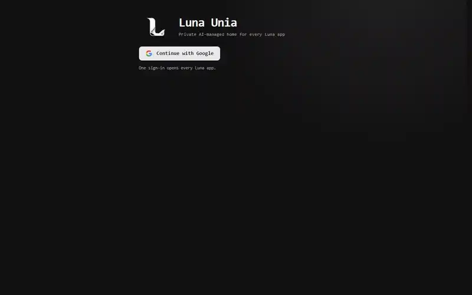
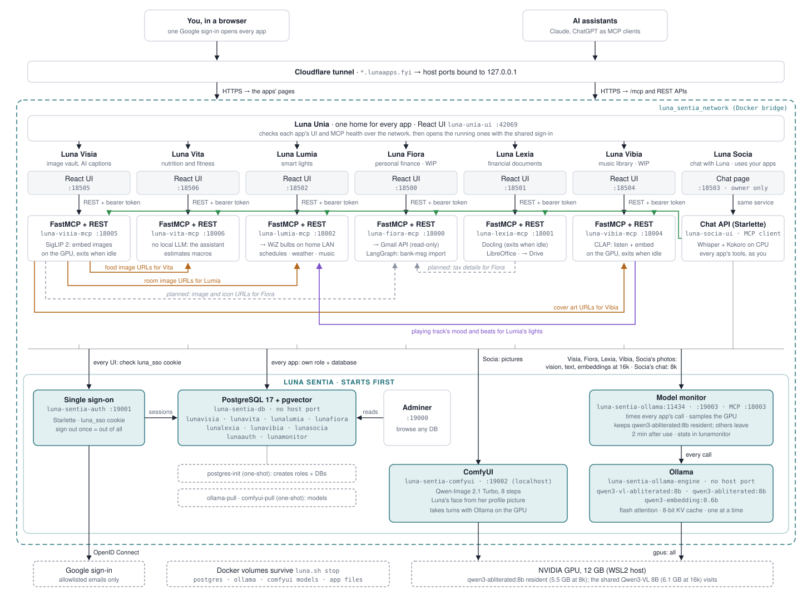

# Luna Sentia


**The shared base every Luna app runs on:** one database, the local models, a single Google sign-in, and the private
network the apps share. Start Sentia and any Luna app you clone beside it with one command.

<p align="center">
  <a href="assets/luna-sentia-showcase.mp4"></a>
</p>

<p align="center"><em>Signing in, adding a person, hiding an app, then the model monitor timing a live question on the
GPU. Select it for the sharper video.</em></p>

## What it provides

- **PostgreSQL 17 + pgvector:** one server, with a separate role and database for each app, and a separate space for
  each person in it.
- **Ollama and its models**, behind a **model monitor** that times every call, samples the GPU, and keeps the chat
  model resident.
- **An image model** (Qwen-Image 2.1) that takes turns with Ollama on the GPU.
- **Single sign-on:** one Google sign-in opens every app. The owner adds people, and hides apps from them, at `/admin`.
- **`luna.sh`**, which starts Sentia, waits until it is healthy, then starts every app you cloned.
- **Adminer** for browsing the databases, and an MCP server so your assistant can read the GPU and model calls.

## The Luna apps



| App | What it is |
| --- | --- |
| [Luna Unia](https://github.com/pranjallk1995/Luna_Unia) | The home page: every app, whether it is running, one click in |
| [Luna Visia](https://github.com/pranjallk1995/Luna_Visia) | Images, captioned and tagged; stores the other apps' pictures (orange lines) |
| [Luna Lexia](https://github.com/pranjallk1995/Luna_Lexia) | Documents, read into structured details; lab reports for Vita (rose line) |
| [Luna Vita](https://github.com/pranjallk1995/Luna_Vita) | Food, water, workouts, body measurements and lab reports |
| [Luna Vibia](https://github.com/pranjallk1995/Luna_Vibia) | Music, listened to and searchable; the lights follow it (purple line) |
| [Luna Lumia](https://github.com/pranjallk1995/Luna_Lumia) | Smart lights and PC RGB |
| [Luna Fiora](https://github.com/pranjallk1995/Luna_Fiora) | Personal finance (early access); grey dashed lines are planned links |
| [Luna Socia](https://github.com/pranjallk1995/Luna_Socia) | The owner's chat with Luna, who uses every app's tools (green line) |

Each app (Socia aside) is a React UI plus an MCP server your AI assistant can connect to. Which app uses which model
is in [Models](https://github.com/pranjallk1995/Luna_Sentia/wiki/Architecture#models).

## Quickstart

Clone Sentia and the apps you want into one folder. On one machine you need no `.env`:

```sh
mkdir Luna && cd Luna
git clone https://github.com/pranjallk1995/Luna_Sentia.git
git clone https://github.com/pranjallk1995/Luna_Visia.git        # and any other Luna_<App> you want
./Luna_Sentia/luna.sh start
```

The first start downloads the models (several GB). Then open Unia at <http://localhost:42069>, or an app at its port,
and sign in as the owner with one click. The default model needs an NVIDIA GPU with 8 GB of VRAM; without one, see
[CPU fallback](https://github.com/pranjallk1995/Luna_Sentia/wiki/Operations#cpu-fallback).

| To | Run |
| --- | --- |
| Start only some apps | `./Luna_Sentia/luna.sh start visia vita` |
| Run your local code changes | `./Luna_Sentia/luna.sh start --build` |
| Sync source changes into the running apps | `./Luna_Sentia/luna.sh start --watch` |
| See or stop the containers | `./Luna_Sentia/luna.sh status [app]`, `./Luna_Sentia/luna.sh stop [app]` |
| Update to newer releases | `git pull` in each folder, then `start` again |

Before giving Luna a public address, set each stack's secrets in its `.env` (see each `.env.example`); `start`
refuses a public address that still uses a localhost default. Details are in
[Start everything](https://github.com/pranjallk1995/Luna_Sentia/wiki/Getting-Started#start-everything).

## Ports

Every port is on `127.0.0.1`; a tunnel routes a public hostname to it.

| | Fiora | Lexia | Lumia | Socia | Vibia | Visia | Vita | Unia |
| --- | --- | --- | --- | --- | --- | --- | --- | --- |
| UI | 18500 | 18501 | 18502 | 18503 | 18504 | 18505 | 18506 | 42069 |
| MCP | 18000 | 18001 | 18002 | | 18004 | 18005 | 18006 | |

Sentia: Adminer 19000, sign-on 19001, model monitor 19003, its MCP server 18003. All of them are in
[Ports](https://github.com/pranjallk1995/Luna_Sentia/wiki/Getting-Started#ports).

## Releases

Each repository's Releases page says what changed and how to upgrade. Upgrade Sentia first when an app's notes ask for
it. The latest releases:

| App | Latest release |
| --- | --- |
| [Luna Sentia](https://github.com/pranjallk1995/Luna_Sentia) | [v2.0.7](https://github.com/pranjallk1995/Luna_Sentia/releases/tag/v2.0.7) |
| [Luna Fiora](https://github.com/pranjallk1995/Luna_Fiora) | Early access: no releases yet, `latest` images from `main` |
| [Luna Lexia](https://github.com/pranjallk1995/Luna_Lexia) | [v2.4.2](https://github.com/pranjallk1995/Luna_Lexia/releases/tag/v2.4.2) |
| [Luna Lumia](https://github.com/pranjallk1995/Luna_Lumia) | [v2.2.0](https://github.com/pranjallk1995/Luna_Lumia/releases/tag/v2.2.0) |
| [Luna Socia](https://github.com/pranjallk1995/Luna_Socia) | [v2.1.3](https://github.com/pranjallk1995/Luna_Socia/releases/tag/v2.1.3) |
| [Luna Unia](https://github.com/pranjallk1995/Luna_Unia) | [v2.0.1](https://github.com/pranjallk1995/Luna_Unia/releases/tag/v2.0.1) |
| [Luna Vibia](https://github.com/pranjallk1995/Luna_Vibia) | [v2.1.2](https://github.com/pranjallk1995/Luna_Vibia/releases/tag/v2.1.2) |
| [Luna Visia](https://github.com/pranjallk1995/Luna_Visia) | [v2.0.3](https://github.com/pranjallk1995/Luna_Visia/releases/tag/v2.0.3) |
| [Luna Vita](https://github.com/pranjallk1995/Luna_Vita) | [v2.3.2](https://github.com/pranjallk1995/Luna_Vita/releases/tag/v2.3.2) |

## Documentation

The [wiki](https://github.com/pranjallk1995/Luna_Sentia/wiki) has the full reference:

| Page | What's in it |
| --- | --- |
| [Home](https://github.com/pranjallk1995/Luna_Sentia/wiki) | What Sentia is |
| [Getting started](https://github.com/pranjallk1995/Luna_Sentia/wiki/Getting-Started) | `luna.sh`, published images, starting Sentia alone, health checks, ports |
| [Architecture](https://github.com/pranjallk1995/Luna_Sentia/wiki/Architecture) | Models and GPU residency, changing a model, image model, model monitor, database, sign-on, users, data model |
| [Operations](https://github.com/pranjallk1995/Luna_Sentia/wiki/Operations) | CPU fallback, the database UI, backups and upkeep |
